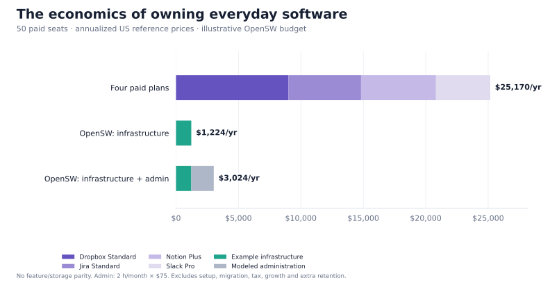
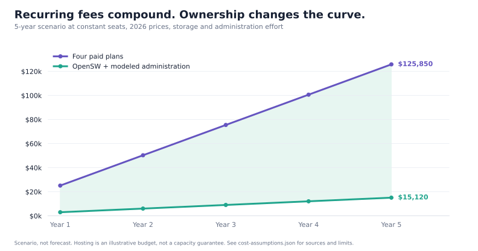

<p align="center">
  
</p>

[](https://github.com/Milad-Afdasta/OpenSW/actions/workflows/ci.yml)

# Own the software your team uses every day.

**Four focused, free applications. Your server. Your data. No OpenSW seat fees.**

OpenSW combines AI-assisted development, a small feature set, and open source to make everyday team software practical to own. Share files, move tasks forward, write useful documentation, and talk with teammates—without buying four growing platforms when you need four straightforward tools.

Install one app or all four. Each is an independent application with its own accounts, process, database, storage, configuration, and browser address. Installing OpenSW Notes does not require OpenSW Chat, Files, or Projects. They can share a machine without sharing identities or data.

**The goal: cover at least 95% of your team's everyday needs with much less complexity.** That is a fit target, not a measured claim about everyone’s usage. Start with your real workflows, check the deliberate omissions below, and use the [weighted fit worksheet](docs/FEATURE-FIT.md) before replacing a paid tool.

## Pick the app you need

| Independent app | Familiar category | Everyday work included | Deliberately left out |
| --- | --- | --- | --- |
| [**OpenSW Files**](apps/files/README.md) | A focused Dropbox alternative | Shared folders, upload/download, filename search, rename, member-only links, recoverable Trash | Desktop sync, public sharing, previews, version history |
| [**OpenSW Projects**](apps/projects/README.md) | A focused Jira alternative | Projects, three-column boards, tasks, assignees, priorities, due dates, comments, archive/restore | Custom workflows, sprints, epics, reports, automations |
| [**OpenSW Notes**](apps/notes/README.md) | A focused Notion alternative | Searchable pages, Markdown, safe preview, explicit Save, conflicting-edit checks, archive/restore | Databases, formulas, rich blocks, nested page trees, live co-editing |
| [**OpenSW Chat**](apps/chat/README.md) | A focused Slack alternative | Channels, private one-to-one messages, conversation search/history, own-message editing/deletion, unread counts | Calls, threads, reactions, attachments, bots, mobile push |

The interfaces use original OpenSW branding, clear actions, and shared light/dark design conventions. There is no mandatory suite dashboard or cross-app login. Within each app, an administrator creates teammates; ordinary team content is shared. Chat DMs are restricted to their two participants, including against other administrators.

Commercial product names identify the category. OpenSW is independently developed and is not affiliated with those vendors.

Read the [ten-product adoption and self-hosting research](docs/SAAS-RESEARCH.md) for published usage metrics, recreation difficulty, and the reasons for this initial selection.

## Tested for real team use

The production setup builds from source, obtains and renews HTTPS certificates, and runs encrypted off-server backups with configurable retention and periodic restore validation. Each app remains independently installable.

| Release check | Observed result |
| --- | --- |
| Four apps running together | 50 concurrent users **per app** for five minutes; 100 per app for a 30-second burst |
| Real API workload | 35,068 total operations, including 20,433 during the measured stages; no unexpected responses or unconfirmed writes |
| Server budget | All apps, HTTPS gateway and backup workers inside one 4-CPU / 6-GiB limit |
| Backups while teammates write | All four encrypted snapshots completed successfully |
| Recovery on an empty server | All four rebuilt from source; 15,840 captured rows and 300 file blobs preserved, including Trash; restored sessions revoked |
| Browser checks | 72 current-interface cases, 16 released-client cases, and 16 recovery cases, across desktop/mobile and light/dark |
| Independent review | Three planners, three developers, then three different manual QA/code reviewers covering all four apps |

These are measured results from a controlled local network with real ACME and S3-compatible services and an explicitly trusted test CA. They establish a tested small-team configuration; they do not establish performance on every provider, public certificate issuance for your domain, or universal feature fit. See the [full validation record](docs/VALIDATION.md) and [machine-readable results](docs/evidence/v0.2.0-summary.json), then size storage—including backup working space—for your own data.

**Real DigitalOcean deployment is also verified.** All four apps were installed on independent Ubuntu servers using bare public IPs and trusted HTTPS, then recovered onto fresh hosts. The audit preserved 1,475 original rows and all 11 referenced file blobs; all 10 temporary servers and their test firewall/key/tag were removed. Follow the [DigitalOcean setup guide](docs/DIGITALOCEAN.md) or inspect the [cloud evidence](docs/evidence/v0.2.1-digitalocean.json). Initial app setup took about 2½–6½ minutes once prerequisites were ready; server/bootstrap time is separate.

## Why the economics change

A subscription bundles software, hosting, support, operations, integrations, and a broad roadmap. That can be good value. A small team may instead want a narrower product and control over its own infrastructure.

OpenSW takes that second route. AI agents help develop focused applications; the resulting source is shared, so every team does not commission the same basic software again. The running apps do not require a paid AI API, hosted OpenSW service account, or license server.

| What you control | OpenSW approach |
| --- | --- |
| Software cost | MIT-licensed source; no OpenSW per-user charge or license timeout |
| Deployment | Your computer or an existing Linux server you control |
| Data | Each app's own persistent SQLite database and storage volume |
| Retention | No OpenSW subscription tier that expires access to retained history; your disk capacity and retention policy still matter |
| Customization | Inspect, modify, and build the public source |
| Backups | Scheduled encrypted backups to your authorized S3-compatible HTTPS storage; your keys, recovery password, schedule and retention |

You take responsibility for operating the software. Updates, access management, monitoring, backups, and recovery still require time or paid help.

<!-- COST-ILLUSTRATION:START -->
## What could a 50-person team save?

This illustration assumes **50 paid seats in each of 4 products**. Prices are US dollars checked **November 8, 2026**, excluding tax, promotions and add-ons.

| Subscription | Listed price per person/month | Billing basis | Annualized cost for 50 |
| --- | ---: | --- | ---: |
| [Dropbox Standard](https://www.dropbox.com/plans?trigger=homepagefoot) | $15.00 | Annual billing | $9,000 |
| [Jira Standard](https://www.atlassian.com/licensing/future-pricing/cloud/list/faqs) | $9.70 | Monthly billing, first 100 users | $5,820 |
| [Notion Plus](https://www.notion.com/pricing) | $10.00 | Annual billing | $6,000 |
| [Slack Pro](https://slack.com/pricing) | $7.25 | Annual billing | $4,350 |
| **Total** | **$41.95** | Mixed billing as stated | **$25,170/year** |

This is a spending example, **not a feature-parity or storage-capacity comparison**. Annual Jira terms, free plans, bundles, negotiated pricing, fewer paid seats or using only one product can lower your actual bill. Replacing a free plan creates no subscription saving.

For a separate hosting illustration, four isolated apps could share a server while keeping their own containers and volumes:

| Illustrative infrastructure budget | Monthly | Annual |
| --- | ---: | ---: |
| [DigitalOcean Basic: 8 GiB RAM, 4 vCPUs, 160 GiB SSD](https://www.digitalocean.com/pricing/droplets) | $48 | $576 |
| [500 GiB additional storage for live data, backup workspace and growth](https://www.digitalocean.com/pricing/volumes) | $50 | $600 |
| 500 GiB encrypted backup repository capacity, rounded budget at [B2's starting $6.95/TB/month rate](https://www.backblaze.com/cloud-storage/pricing) | $4 | $48 |
| **Infrastructure illustration** | **$102** | **$1,224** |
| Optional administration: 2 hours/month at $75/hour | $150 | $1,800 |
| **Including that administration allowance** | **$252** | **$3,024** |

The local-storage example assumes **at most 100 GiB of total app data**, including Trash, across all four apps. Allow approximately **3× the uncompressed snapshot size as free backup-verification workspace**, in addition to live data and Docker images; see [backup workspace](docs/BACKUP-AND-RECOVERY.md). The 500 GiB volume budget covers that working space and growth margin. The operator must make this storage available to Docker's app and backup volumes; it is not a promise of 500 GiB of live-file capacity.

The remote 500 GiB is **repository capacity for retained snapshots**, not unlimited history or an additional 500 GiB live dataset. Actual change rate, retention and deduplication determine usage. Additional transfer, domains, taxes, setup, migration and growth can change costs.

The 4-vCPU/8-GiB server is in a similar CPU/memory class to the controlled 4-CPU/6-GiB test fixture. This is **not a benchmark or capacity guarantee for that provider plan**. Full capacity, recovery and release conclusions depend on the [validation record](docs/VALIDATION.md); no paid provider account was created for this illustration.

With those assumptions, annual infrastructure-only savings are **$23,946 (95.1%)**. Including the administration allowance gives **$22,146 (88.0%)**. Neither percentage measures feature coverage.



Keeping the same prices and usage for 5 years produces **$125,850** in subscriptions versus **$15,120** for the illustrated infrastructure and administration: a **$110,730 difference**, before migration. This is simple arithmetic, not a price forecast.



Use your invoices and measured operating costs to calculate your own result. A solo user with inexpensive subscriptions may spend more maintaining a replacement; a team paying many seat fees has more room to save.

<!-- COST-ILLUSTRATION:END -->

## Download, run one file, answer a few questions

Get the repository through GitHub's **Code → Download ZIP**, extract it, and open a terminal in that folder. Or clone it:

```sh
git clone https://github.com/Milad-Afdasta/OpenSW.git
cd OpenSW
./install.sh
```

For an extracted ZIP, `sh install.sh` runs the same entry point if your system has not preserved its executable permission.

The wizard asks which app to install, your team name, and whether to run on this computer or an existing server. Server installation additionally needs its address, login username, and SSH key **file path**. The administrator password is entered through a hidden prompt. For public access, the wizard also collects your app's public IPv4 address or DNS hostname, certificate email and existing storage details, with hidden prompts for storage keys and a backup recovery password.

The installer validates the configuration, builds the selected application from this source, starts its independent container, and checks readiness. When Docker, SSH authentication, or a verified host key needs attention, it explains the manual action, pauses, then checks again before continuing. It does not ask you to paste private keys into chat or commit credentials.

You need **Python 3.11+ and stable Docker Engine 28.0.0 or newer on the selected target**. Use a currently patched Docker release. The installer checks the target daemon's reported version before creating managed resources; an older, prerelease or unknown version stops setup. Update that target's Docker without deleting its existing volumes, then let setup recheck. Application dependencies are built inside Docker; host Node/npm and application Python packages are unnecessary. Setup has been verified with Linux Docker hosts and macOS Docker Desktop. Windows through WSL2 is a documented setup path and is **NOT_RUN** in this validation. An existing remote Linux server must already have suitable Docker and SSH access.

The supported host uses standard protected Docker bridge/NAT/firewall isolation. Intentional direct routing, trusted-interface exposure, routed or unprotected network modes, disabled firewall/raw-table protections, and host rules exposing private backends are unsupported configurations. The operator remains responsible for host/provider networking. The version check establishes a [localhost-publication minimum](https://docs.docker.com/engine/network/port-publishing/); it does not attest the host firewall or certify arbitrary networking changes.

Setup prints its measured elapsed time. First-time dependency downloads, certificate issuance, prerequisite setup and the first verified backup can take longer than a cached local install.

## A small configuration file for each app

The wizard creates a private, ignored `*.local.toml` file. The normal configuration is this short:

```toml
app = "files"
team_name = "My team"
run_on = "this-computer"
server_address = ""
server_username = ""
server_key_file = ""
```

Keep server fields blank for local use. For a server, select `my-server` and fill them in. Optional advanced settings cover another instance name, port, SSH port, or Files upload limit. Read the [plain-language configuration guide](docs/CONFIGURATION.md).

| App | Example configuration | Default local port | AI setup/test instructions |
| --- | --- | ---: | --- |
| Files | [config.example.toml](apps/files/config.example.toml) | 8081 | [Files AGENTS.md](apps/files/AGENTS.md) |
| Projects | [config.example.toml](apps/projects/config.example.toml) | 8082 | [Projects AGENTS.md](apps/projects/AGENTS.md) |
| Notes | [config.example.toml](apps/notes/config.example.toml) | 8083 | [Notes AGENTS.md](apps/notes/AGENTS.md) |
| Chat | [config.example.toml](apps/chat/config.example.toml) | 8084 | [Chat AGENTS.md](apps/chat/AGENTS.md) |

Copy an example before entering private details, then use that one file:

```sh
cp apps/files/config.example.toml files.local.toml
chmod 600 files.local.toml
./install.sh plan --config files.local.toml
./install.sh --config files.local.toml
```

Defaults use separate `.localhost` names as well as ports. Private existing-server access uses a printed SSH tunnel command. Public deployments use automatic HTTPS and encrypted off-host backups through two optional sections:

```toml
[https]
domain = "files.example.com"
email = "admin@example.com"

[backups]
repository = "s3:https://storage.example.com/my-backup-bucket"
credentials_file = "/private/storage-credentials.env"
password_file = "/private/recovery-password.txt"
```

You supply a public IPv4 address (one app per server) or a domain pointing to your server, incoming TCP ports 80/443, and an authorized storage bucket. OpenSW obtains and renews the certificate, schedules encrypted backups, and checks an initial restore. It does not buy a domain, provision a cloud machine or create a paid storage account. See [configuration](docs/CONFIGURATION.md) and [backup and recovery](docs/BACKUP-AND-RECOVERY.md).

An existing deployment changes source or origin only through an explicit command:

```sh
./install.sh upgrade --config files.local.toml
./install.sh status --config files.local.toml
./install.sh backup --config files.local.toml
```

`reconfigure` uses the same checked transition as `upgrade`. Origin changes revoke sessions; teammates sign in again. Keep the original configuration and a verified backup before changing a deployment.

## Verify the installation yourself

Run the included end-to-end API checks against the app you installed:

```sh
./verify.sh --config files.local.toml
```

The verifier uses hidden administrator input, creates two uniquely named temporary teammates and its own fixtures, exercises real workflows and rejection paths, and reports `PASS`, `FAIL`, or `BLOCKED` with route coverage and diagnostic commands. It preserves existing operator accounts and content.

Cleanup is soft: test users are deactivated; files are trashed, notes/projects archived, and chat messages tombstoned. Some QA records remain, including Chat channels and DMs. A failed or unrun required route is not a pass. Optional real-browser checks and their development prerequisites are documented in [tests/browser](tests/browser/README.md) and each app's AI guide.

## Source, ownership, and practical limits

The application builds from source with visible Dockerfiles, pinned base images, and locked dependencies. The HTTPS gateway and backup binary use pinned upstream Caddy and Restic images. There is no verified prebuilt OpenSW app package. Read [Security and builds](docs/SECURITY-AND-BUILDS.md) before deployment.

Follow the [backup and recovery procedure](docs/BACKUP-AND-RECOVERY.md) to configure scheduled backups, inspect health and recover onto an empty target. Trash and archives retain data and consume space; they are not backups. Ordinary installer reruns preserve accounts, data, and the installed image, and do not silently upgrade a deployment. Operators still own monitoring, provider access, safe recovery-password custody and recovery rehearsals. Current production validation is recorded separately from the earlier release's results in [Validation](docs/VALIDATION.md).

OpenSW is a focused starting point for teams that value simplicity and ownership. Try one real workflow with a teammate, run the verifier, and use the [fit worksheet](docs/FEATURE-FIT.md) to decide what belongs in-house.

Original OpenSW source is available under the [MIT License](LICENSE).
Third-party frontend license notices are included in [the source and built apps](web/public/third-party-notices.txt); Python distributions retain their installed license files. The bundled Restic binary's [BSD license](operations/RESTIC-LICENSE.txt) accompanies it in the app image. [Security and builds](docs/SECURITY-AND-BUILDS.md#third-party-components) lists upstream components and notices.
