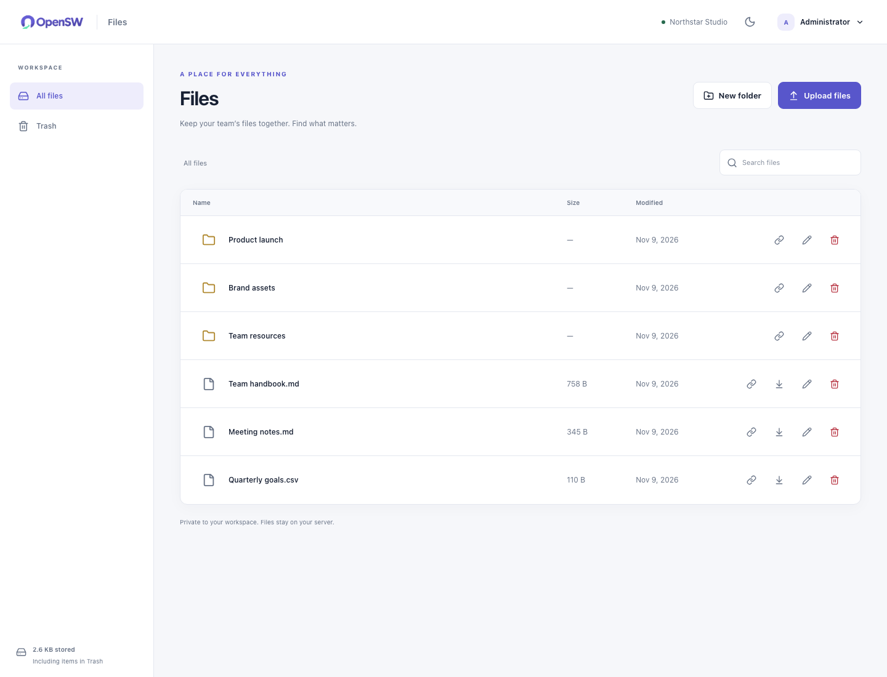
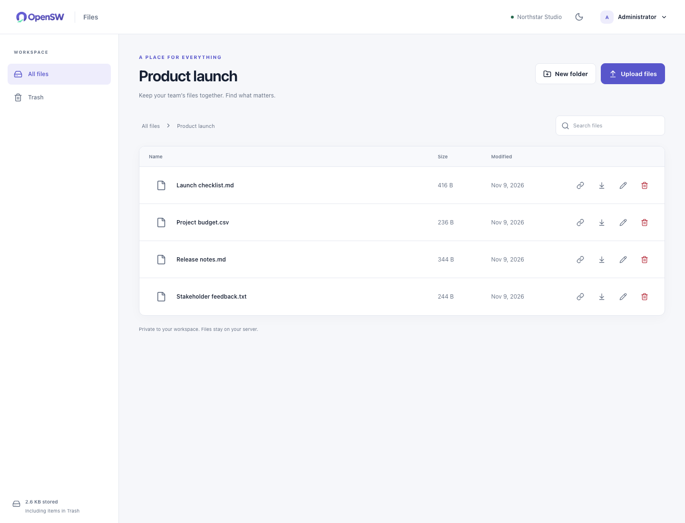
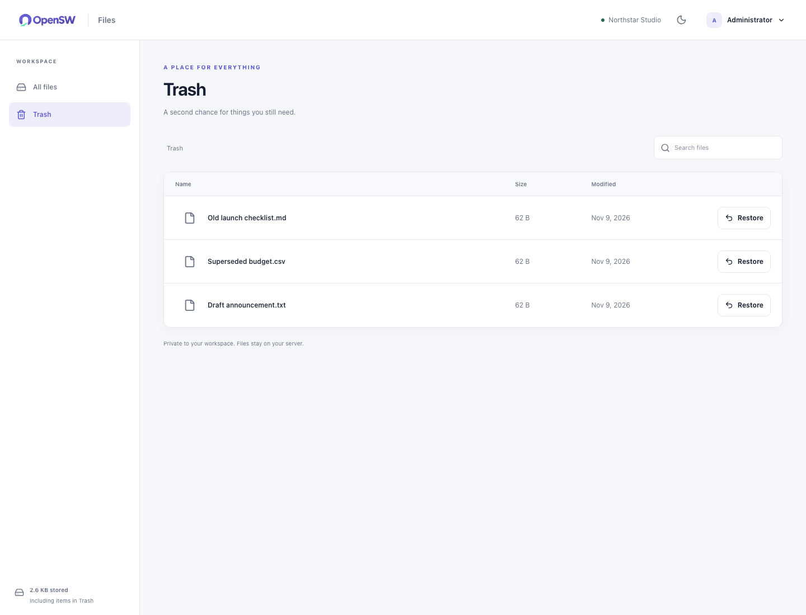

# OpenSW Files

A straightforward home for your team's files.

This is an independent, self-hosted application. It has its own login accounts, server process, database, storage, and configuration. You can run it alone; none of the other OpenSW apps is required.

## Everyday features

- Shared folders and filename search
- Upload and download files
- Rename files and folders
- Member-only file links
- Recoverable Trash and restore

## Screenshots

Desktop light mode with demo data. Select an image to open it at full size.

### Shared workspace

Folders, shared files, uploads and filename search.

[](../../docs/screenshots/files/01-workspace.png)

### Inside a folder

Browse project files with breadcrumbs, downloads and file actions.

[](../../docs/screenshots/files/02-folder.png)

### Trash

Find retained files and restore them to the workspace.

[](../../docs/screenshots/files/03-trash.png)

## Get started

From the repository root, run:

```sh
./install.sh
```

Choose **OpenSW Files**, then **this computer** or **an existing server**. The installer asks for the necessary details, checks prerequisites, builds the app from the public source, and verifies readiness.

For a supplied configuration file:

```sh
./install.sh --config apps/files/config.example.toml
```

Copy the example to a private `*.local.toml` file before entering server details. The normal fields are the team name, where to run, and—only for a server—its address, login name, and SSH key file. The separate `[advanced]` section is optional. Passwords are entered through a hidden prompt, not stored in a public example.

Docker must be installed and running. The small installer also needs Python 3.11 or newer. The app's Node and Python dependencies are built inside Docker; you do not install those development packages on the host.

The default local port is **8081**. The installer prints the actual address after the readiness check. Private existing-server access uses a printed SSH tunnel command. For public access, enable the optional `[https]` and `[backups]` sections: the installer manages certificates and encrypted backups using your public IPv4 address (one app/server) or DNS hostname, server and authorized storage. It does not purchase domains, servers or storage. See the [configuration guide](../../docs/CONFIGURATION.md).

## First useful workflow

Create a folder, upload a small file, then sign in as another teammate and download it.

## Accounts and data

Every active teammate in this app can access its ordinary team content. Accounts in other OpenSW apps are separate, even when their usernames match.

Both the SQLite database and UUID-named file contents live in this app's own persistent volume. Trashed files remain stored, so include them when planning capacity.

Stopping or rerunning the same installation preserves its volume and accounts. Optional encrypted off-host backups run every six hours by default, with a first full restore check and weekly restore verification. Check `./install.sh status --config path/to/files.local.toml`; request a manual capture with `./install.sh backup --config path/to/files.local.toml`. Keep the recovery password safely outside the server. See [backup and recovery](../../docs/BACKUP-AND-RECOVERY.md) for retention, health and recovery onto an empty target.

## Deliberately outside this release

- Desktop synchronization
- Document editing and file previews
- File version history
- Public sharing links
- Permanent deletion and automatic storage reclamation

OpenSW focuses on a defined everyday feature set. It does not claim feature parity with a commercial platform or a measured percentage of every team's requirements.

## Source and verification

Run the complete installed-app check with `./verify.sh --config path/to/files.local.toml`. It creates temporary test members and reports every required API route as passed, failed, or blocked. See the [API examples and diagnostics](../../docs/API.md), including cookie/CSRF requests with curl, and this app's [AI setup instructions](AGENTS.md).

The [main README](../../README.md) explains installation and ownership. The [approved model](../../docs/MODEL-CLOSURE.md) documents the data and lifecycle invariants. API and browser checks are maintained under [tests](../../tests); the public CI workflow builds all four app variants.
