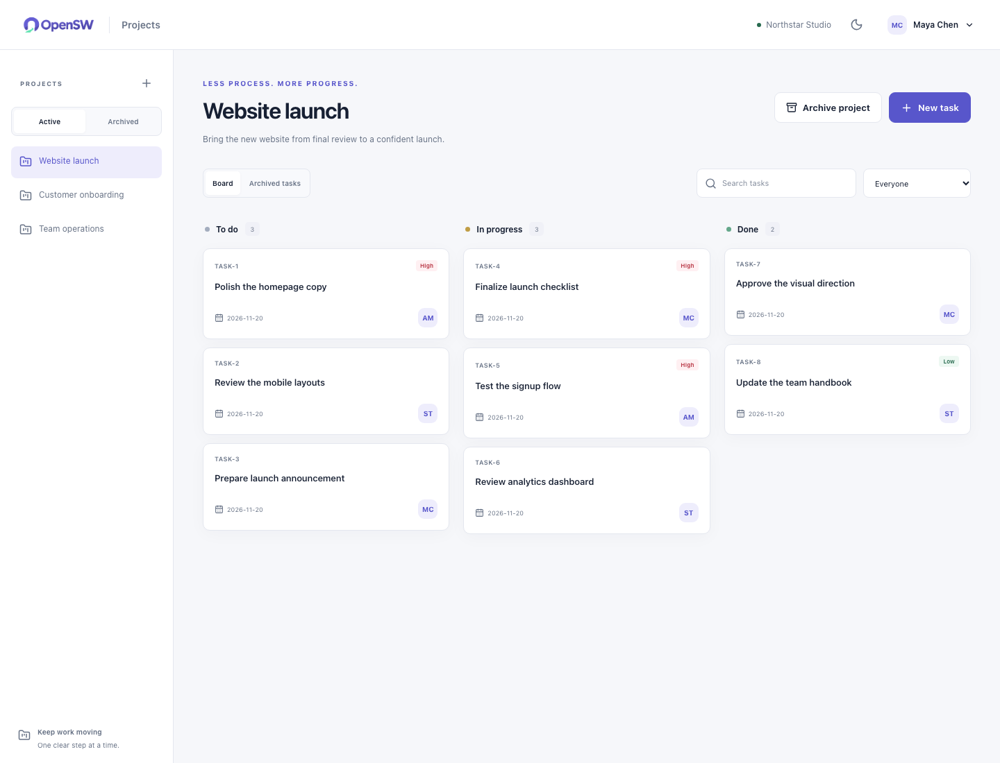
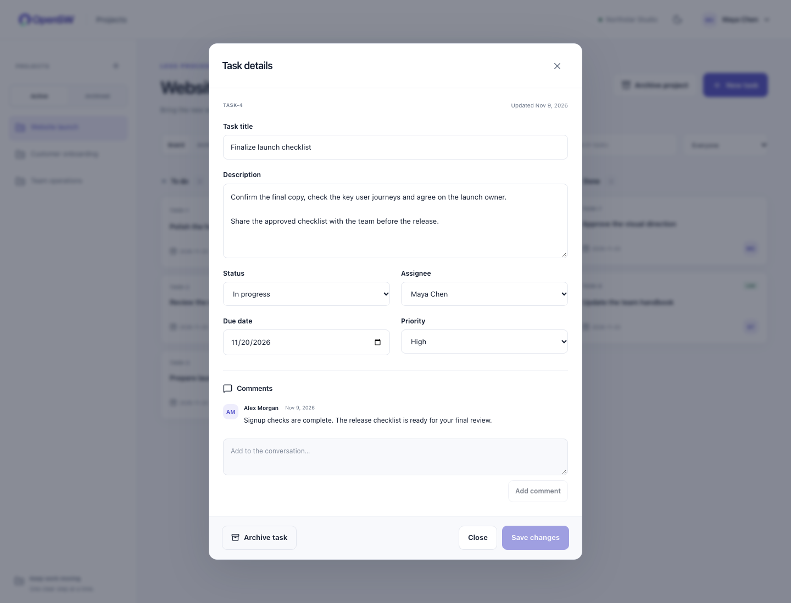
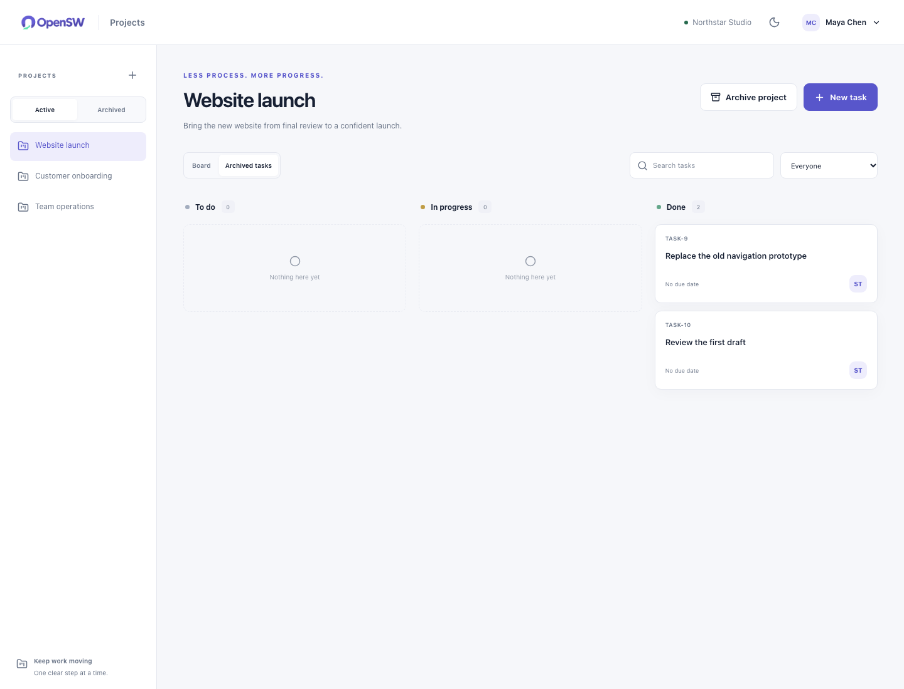

# OpenSW Projects

A clear board for moving everyday work forward.

This is an independent, self-hosted application. It has its own login accounts, server process, database, storage, and configuration. You can run it alone; none of the other OpenSW apps is required.

## Everyday features

- Projects and a To do / In progress / Done board
- Tasks with descriptions, assignees, priorities, and optional due dates
- Task comments
- Title search
- Archive and restore

## Screenshots

Desktop light mode with demo data. Select an image to open it at full size.

### Project board

See tasks across To do, In progress and Done, with owners, priorities and due dates.

[](../../docs/screenshots/projects/01-board.png)

### Task details

Edit the description and assignment, change status, and keep comments with the task.

[](../../docs/screenshots/projects/02-task-details.png)

### Archived tasks

Review completed or archived work without losing its details.

[](../../docs/screenshots/projects/03-archived-tasks.png)

## Get started

From the repository root, run:

```sh
./install.sh
```

Choose **OpenSW Projects**, then **this computer** or **an existing server**. The installer asks for the necessary details, checks prerequisites, builds the app from the public source, and verifies readiness.

For a supplied configuration file:

```sh
./install.sh --config apps/projects/config.example.toml
```

Copy the example to a private `*.local.toml` file before entering server details. The normal fields are the team name, where to run, and—only for a server—its address, login name, and SSH key file. The separate `[advanced]` section is optional. Passwords are entered through a hidden prompt, not stored in a public example.

Docker must be installed and running. The small installer also needs Python 3.11 or newer. The app's Node and Python dependencies are built inside Docker; you do not install those development packages on the host.

The default local port is **8082**. The installer prints the actual address after the readiness check. Private existing-server access uses a printed SSH tunnel command. For public access, enable the optional `[https]` and `[backups]` sections: the installer manages certificates and encrypted backups using your public IPv4 address (one app/server) or DNS hostname, server and authorized storage. It does not purchase domains, servers or storage. See the [configuration guide](../../docs/CONFIGURATION.md).

## First useful workflow

Create a project and task, assign a teammate, move the task to In progress, and add a comment.

## Accounts and data

Every active teammate in this app can access its ordinary team content. Accounts in other OpenSW apps are separate, even when their usernames match.

Projects, tasks, comments, teammate identities, and archived records live in this app's own SQLite database. Archiving preserves records.

Stopping or rerunning the same installation preserves its volume and accounts. Optional encrypted off-host backups run every six hours by default, with a first full restore check and weekly restore verification. Check `./install.sh status --config path/to/projects.local.toml`; request a manual capture with `./install.sh backup --config path/to/projects.local.toml`. Keep the recovery password safely outside the server. See [backup and recovery](../../docs/BACKUP-AND-RECOVERY.md) for retention, health and recovery onto an empty target.

## Deliberately outside this release

- Sprints, epics, and estimates
- Custom fields and workflow builders
- Dependencies and automation
- Marketplace integrations
- Reports and billing

OpenSW focuses on a defined everyday feature set. It does not claim feature parity with a commercial platform or a measured percentage of every team's requirements.

## Source and verification

Run the complete installed-app check with `./verify.sh --config path/to/projects.local.toml`. It creates temporary test members and reports every required API route as passed, failed, or blocked. See the [API examples and diagnostics](../../docs/API.md), including cookie/CSRF requests with curl, and this app's [AI setup instructions](AGENTS.md).

The [main README](../../README.md) explains installation and ownership. The [approved model](../../docs/MODEL-CLOSURE.md) documents the data and lifecycle invariants. API and browser checks are maintained under [tests](../../tests); the public CI workflow builds all four app variants.
